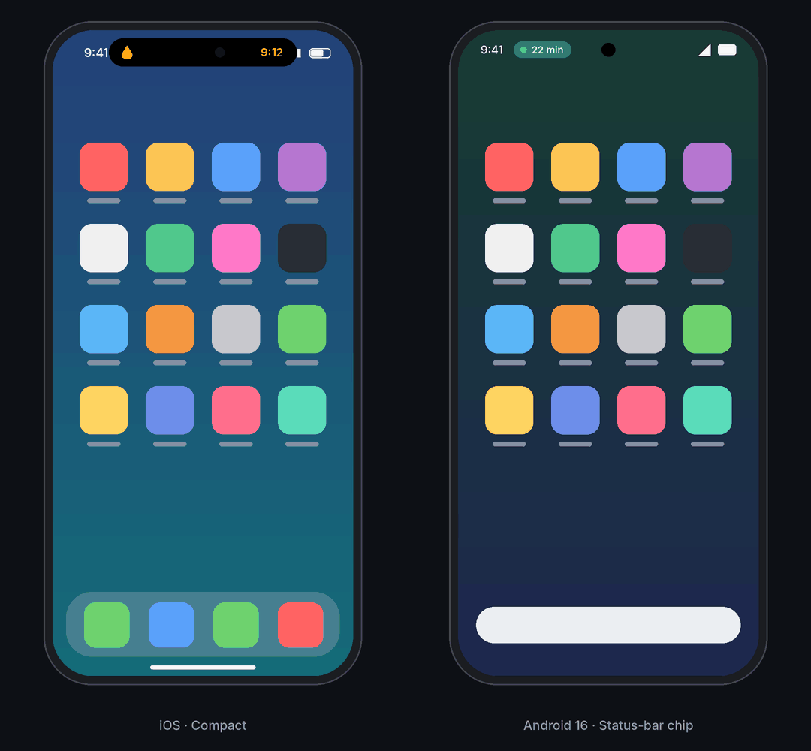
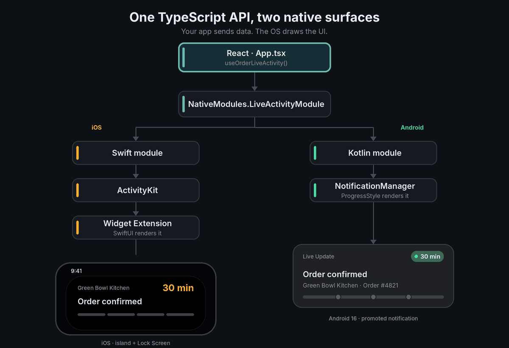

# Live Activities in React Native (iOS + Android)

A React Native sample that shows a **live order tracker** outside the app:

- **iOS:** a Live Activity on the **Dynamic Island** (the pill around the front camera) and the **Lock Screen**, built with ActivityKit, WidgetKit and SwiftUI.
- **Android:** an ongoing notification that becomes a promoted **Live Update** on Android 16+ (`Notification.ProgressStyle` + status-bar chip). Older Android versions get a regular progress notification.



*Illustrative mockups of the sample's layouts.*

The same JavaScript API drives both platforms:

```ts
const id = await LiveActivity.start(order, { step: 0, statusText: 'Order confirmed', etaTimestamp });
await LiveActivity.update(id, { step: 2, statusText: 'Your order is on the way', etaTimestamp });
await LiveActivity.end(id, { step: 3, statusText: 'Delivered. Enjoy!', etaTimestamp });
```

## How it works



```
React (App.tsx)
   │  useOrderLiveActivity()  ── src/liveActivity/
   ▼
NativeModules.LiveActivityModule
   ├── iOS:     modules/live-activity/ios/LiveActivityModule.swift ──► ActivityKit
   │                                                                     │
   │            ios/LiveActivityWidget/ (Widget Extension, SwiftUI) ◄────┘  iOS renders the UI
   │
   └── Android: android/app/.../liveactivity/LiveActivityModule.kt ──► NotificationManager
                OrderNotification.kt (ProgressStyle Live Update / progress notification)
```

The app never draws the island or the notification itself. It sends **data**, and the system renders the UI. Countdowns use the ETA timestamp, so the OS animates them without per-second updates from JavaScript.

## Project layout

| Path | What it is |
| --- | --- |
| `App.tsx` | Demo screen: start, advance and cancel an order |
| `src/liveActivity/index.ts` | Typed, cross-platform JS API |
| `src/liveActivity/useOrderLiveActivity.ts` | React hook tying the activity to a screen's lifecycle |
| `modules/live-activity/` | iOS native module (local CocoaPod): Swift + ActivityKit |
| `modules/live-activity-shared/` | `OrderActivityAttributes`, the one data model shared by the app and the widget (local CocoaPod, no React dependency) |
| `ios/LiveActivityWidget/` | SwiftUI sources for the Widget Extension (island + Lock Screen) |
| `android/app/src/main/java/com/liveactivitiesdemo/liveactivity/` | Android native module + notification builder |

## Requirements

- Node 20+, Xcode 16+, CocoaPods, Android Studio with SDK 36 (Android 16)
- iOS 16.2+ for Live Activities (the app itself runs on lower versions; the feature reports as unsupported)
- An iPhone with the camera pill, or a **Pro** simulator, to see the island view

## Setup

```sh
npm install
cd ios && pod install && cd ..
```

### iOS: add the Widget Extension (one-time, about 2 minutes)

Xcode targets can't be safely generated from the command line, so add this one by hand:

1. Open `ios/LiveActivitiesDemo.xcworkspace` in Xcode.
2. **File → New → Target → Widget Extension**. Name it `OrderTrackerWidget`, tick **Include Live Activity**, untick **Include Configuration App Intent**. When asked, **Activate** the scheme.
3. In the new `OrderTrackerWidget` group, **delete the generated `.swift` files** (Move to Trash). Keep `Info.plist` and `Assets.xcassets`.
4. Drag the 2 files from `ios/LiveActivityWidget/` into the `OrderTrackerWidget` group. Untick "Copy items if needed", and set **Target Membership** to `OrderTrackerWidget` only.
5. Select the `OrderTrackerWidget` target → **General** → set **Minimum Deployments** to **iOS 16.2**.
6. Run `cd ios && pod install` again. The Podfile detects the new target and links the shared `OrderActivityShared` pod into it.
7. Run the `LiveActivitiesDemo` scheme on a device or Pro simulator.

`NSSupportsLiveActivities` is already enabled in the app's `Info.plist`.

> `OrderActivityAttributes` lives in one place, the `OrderActivityShared` pod, which both the app and the widget link. There's no copy to keep in sync.

### Android

```sh
npm run android
```

Accept the notification permission when you start an order. On Android 16+, if the notification isn't promoted, tap **Live Update settings** in the app to allow Live Updates.

## Try it

1. Tap **Start order**.
2. **iOS:** go to the Home Screen (the pill at the top) or lock the phone (Lock Screen). Long-press the island for the expanded view. **Android:** pull down the shade or lock the phone.
3. Tap **Next step** to move through *confirmed → preparing → on the way → delivered*.

## Gotchas

- **Fast Refresh doesn't reload native code.** Rebuild after changing Swift or Kotlin.
- **Activity starts but nothing shows (iOS):** check that the widget target exists and is embedded in the app, that Live Activities are enabled in the app's Settings, and that you re-ran `pod install` after creating the widget target.
- **Background updates:** JavaScript only runs while the app is active. For server-driven updates, use ActivityKit push tokens (`pushType: .token`) on iOS and FCM data messages on Android.
- **Limits:** iOS ends a Live Activity after about 8 hours (it can stay on the Lock Screen for up to 4 more) and caps its data at 4 KB. Android Live Updates must be ongoing, uncolorized and use an allowed style. Don't repost one the user dismissed.
- **Icons:** the Android notification uses a system placeholder icon. Replace it with your app's monochrome icon.

## License

MIT
